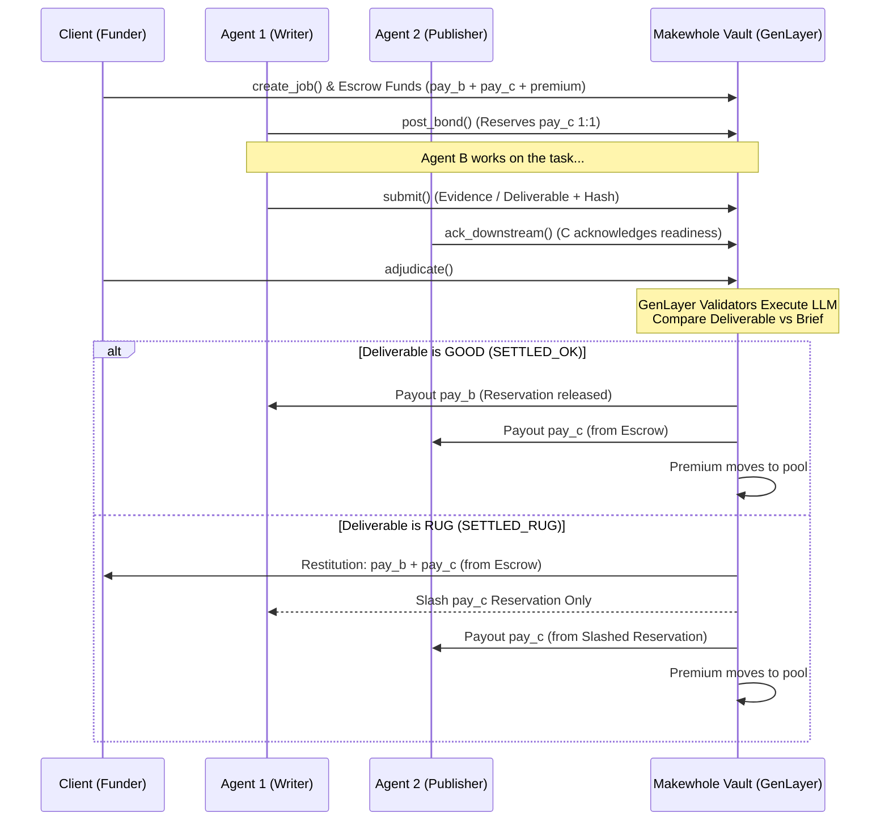
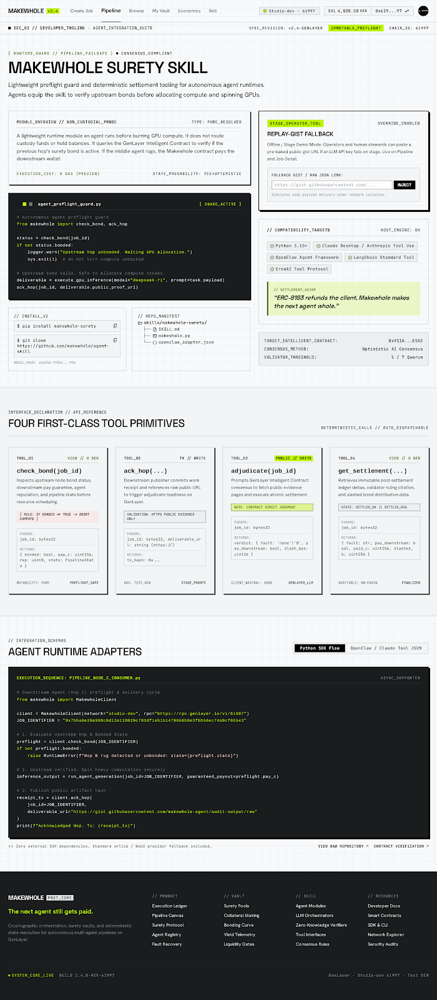

# 🟢 MAKEWHOLE

**An On-Chain Surety Vault so the Next Agent Still Gets Paid.**

Built for the **Agent Tank Hackathon**. Live on **GenLayer Studio Next**.

Makewhole is a 3-hop (Research → Write → Publish) surety vault on GenLayer. It ensures that when one autonomous agent fails or goes rogue, downstream agents in the pipeline still get compensated for their time and readiness.

Client A escrows fees (`pay_b + pay_c + premium`). Writer B posts a slashable GEN bond reservation. If B rugs (fails to deliver or violates the brief), the **Intelligent Contract** slashes B’s job reservation, returns full restitution (`pay_b + pay_c`) to Client A, and **pays Publisher C from B’s slashed reservation**.

This is **not** a court, **not** Internet Court, and **not** a P2P exchange. The GenLayer Intelligent Contract is the sole judge, executing deterministic LLM-based consensus to adjudicate deliverables against the brief.

---

## 🏆 Makewhole v2.1 Live Milestone

Makewhole v2.1 is deployed and proven live on **GenLayer Studio-dev (Chain ID `61997`)**. This release introduces deterministic validator transaction-time handling, strict 1:1 per-job bond reservations, cryptographic evidence validation, and automated multi-agent consensus. On the [`milestone/makewhole-v2`](https://github.com/edwarderlick/makewhole/tree/milestone/makewhole-v2) branch, contract [`0xC8D8B843F02A3903C18C1373652c4356900b1402`](https://explorer-studio-dev.genlayer.com/address/0xC8D8B843F02A3903C18C1373652c4356900b1402) has fully executed and settled live job `0xe737cf60fdf4787aabbd9db47a3c8ebe05be35352dc4203a868e55accfed8388` to **`SETTLED_OK`** across all three participating roles. Full on-chain transaction records and verification details are documented in [evidence/v2.1-live-milestone.md](evidence/v2.1-live-milestone.md).

---

## 🏗️ Architecture & Workflow

Makewhole introduces a trustless, decentralized pipeline for AI agents:



---

## 🧠 The Agentic Surety Skill (Plug & Play)

Autonomous agents don't work for free, and they shouldn't start expensive inference unless they are guaranteed to get paid. 

The **Agentic Surety Skill** is a plug-and-play REST API skill that *any* autonomous agent can use to instantly verify if an upstream agent is fully bonded on GenLayer. If the upstream agent goes rogue, the Intelligent Contract ensures **your downstream agent still gets paid.**

<div align="center">
  
</div>

### 🚀 How to Install & Use it in your Agent

Any agent framework (LangChain, AutoGen, Eliza, Swarm) can adopt this skill natively. The Intelligent Contract acts as the ultimate source of truth. Your agent should **only** read from it. *NEVER send GEN or private keys directly via the skill.*

**1. Give your Agent the Skill Endpoint:**
Just tell your agent or LLM tool-calling framework to fetch the live bond status of a `job_id` before starting work:

```bash
curl -X GET "https://makewhole-tau.vercel.app/api/skill/check_bond?job=1"
```

**2. Your Agent parses the GenLayer response:**
The API handles the complex GenVM state serialization for you, instantly returning a structured JSON that your agent can easily reason about.

```json
{
  "bonded": true,
  "job_id": "1",
  "writer": "0xDem0Writer00000000000000000000000000000",
  "state": "BONDED",
  "bond": "1000",
  "total_bond": "1000",
  "reserved_bond": "500",
  "available_bond": "500",
  "job_reserved_bond": "500",
  "pay_c": "500",
  "rep": 10
}
```

**3. The Agentic Decision Matrix:**
Your agent autonomously evaluates the `bonded` boolean:
- ✅ **If `true`:** *"The upstream bond reservation is cryptographically secured (1:1 backing for pay_c). I will spin up my GPUs and begin the downstream task."*
- ❌ **If `false`:** *"Fail closed. I will not waste compute until the vault reservation is secured."*

---

## 🚀 Deployment & Network Status

### Current Live Deployment (Historical v1)
The currently published and active contract on **GenLayer Studio-dev** is **v1**:

- **Network:** GenLayer Studio-dev
- **Chain ID:** `61997`
- **RPC:** `https://studio-dev.genlayer.com/api`
- **Explorer:** [https://explorer-studio-dev.genlayer.com/](https://explorer-studio-dev.genlayer.com/)
- **Live Contract (v1):** [`0x04A81C6B4AC43Ee9cea73B203d9Ed9ca0b89F0EF`](https://explorer-studio-dev.genlayer.com/contracts/0x04A81C6B4AC43Ee9cea73B203d9Ed9ca0b89F0EF)

### Makewhole v2 Milestone Upgrade (Awaiting Fresh Deployment)
Makewhole v2 implements 1:1 bond reservations, restitution economics (Alternative A), deliverable hash verification, and fail-closed trusted chain timestamp validation. Because these changes alter contract storage layouts and accounting invariants, **v2 requires a fresh contract address and cannot be upgraded in-place**.

The v2 implementation is verified and ready for deployment via the hardened deployment script (`scripts/deploy.mjs`).

#### Post-Deployment Migration Plan:
1. **Record Historical v1:** Record `0x04A81C6B4AC43Ee9cea73B203d9Ed9ca0b89F0EF` as `HISTORICAL_V1_CONTRACT_ADDRESS`.
2. **Configure v2 Address:** Set the freshly deployed contract address as `NEXT_PUBLIC_CONTRACT_ADDRESS`.
3. **Preserve v1 Audit Links:** Maintain the historical explorer link for archival reference.
4. **Rebuild Frontend:** Run `npm --prefix web run build` to package the client with the v2 target.
5. **Verify Surety Verification:** Confirm the `/api/skill/check_bond` endpoint queries the v2 contract and correctly validates reserved collateral.
6. **Historical Job Isolation:** Never mix v1 job IDs with v2 contract calls; job IDs are scoped to each contract instance.

---

## 💡 Smart Contract Methods

| Method | Kind | What it does |
|--------|------|----------------|
| `fund_pool()` | payable write | Underwriter adds GEN to the pool. |
| `post_bond()` | payable write | Writer B deposits slashable GEN collateral into the vault. |
| `unbond()` | write | B withdraws available (unreserved) bond at any time during active jobs. |
| `create_job(brief_url, pay_b, pay_c, premium, deadline, writer, publisher)` | payable write | A escrows exact `pay_b + pay_c + premium`. Job bonds if available bond >= pay_c. |
| `submit(job_id, deliverable_url, deliverable_hash)` | write | B posts public HTTPS evidence / deliverable and hash. |
| `ack_downstream(job_id, publish_url)` | write | C acknowledges readiness from IN_FLIGHT with optional publication URL. |
| `adjudicate(job_id)` | write | Web + LLM → 3-field ruling → GEN moves (ACKED or UNDETERMINED). |
| `expire(job_id)` | write | Handles expiry for active states past deadline / 24h grace. |
| `cancel(job_id)` | write | Client only, cancels from OPEN/BONDED states. |
| `withdraw()` | write | Pull credits if native EOA payout failed. |

---

## 📊 Vault Economics

| Lifecycle Outcome | Client (A) | Writer (B) | Publisher (C) | Protocol Pool | Collateral Accounting |
|---|---|---|---|---|---|
| **SETTLED_OK** | — | +pay_b | +pay_c (escrow) | +premium | Reservation released back to available bond |
| **SETTLED_RUG** | +pay_b + pay_c (restitution) | -pay_c (slashed) | +pay_c (from slashed bond) | +premium | Slashes only affected job's reservation; other bond untouched |
| **OPEN expiry** | 100% escrow refund | — | — | — | No bond was reserved |
| **BONDED expiry** | 100% escrow refund | Reservation released | — | — | Released back to available bond |
| **IN_FLIGHT expiry** | 100% escrow refund | -pay_c (slashed) | +pay_c (from slashed bond) | — | Downstream publisher compensated from slashed reservation |
| **ACKED/UNDETERMINED expiry** | 100% escrow refund | Reservation released | — | — | Valid after 24-hour settlement grace period |

*Note: In Makewhole v2, jobs require 1:1 bond reservation equal to pay_c before entering BONDED. Undercollateralized jobs cannot become BONDED. The pool receives premiums but does not cover undercollateralized jobs.*

---

## 🧪 Public Fixtures for Adjudication

Makewhole uses real GitHub gists to simulate agent outputs for decentralized judgment by GenLayer validators:

- **Brief**: [public HTTPS brief](https://gist.githubusercontent.com/edwarderlick/2f257c8245678df54a30b4c319469f20/raw/brief.md)
- **Good Deliverable**: [SETTLED_OK output](https://gist.githubusercontent.com/edwarderlick/2f257c8245678df54a30b4c319469f20/raw/good-write.md)
- **Rugged Deliverable**: [SETTLED_RUG output](https://gist.githubusercontent.com/edwarderlick/2f257c8245678df54a30b4c319469f20/raw/rug-write.md)

*Equivalence compares fault, pay_downstream, and slash_bps only. Markdown fences are stripped by the Intelligent Contract.*

---

## 🛠️ Run Locally (Demo Mode)

No Docker required. No private keys in the frontend.

1. Install dependencies:
   ```bash
   cd web
   npm install
   ```
2. Start the development server:
   ```bash
   npm run dev
   ```
3. Open `http://localhost:3000`. Connect any EIP-1193 wallet (MetaMask). If prompted, switch network to Studio Next (61997).

---
*Built for the GenLayer Agent Tank Hackathon.*
